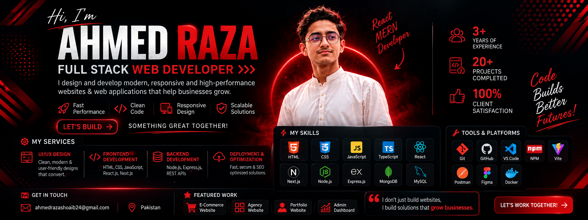

  

---

## 🚀 About Me

- 👨‍💻 I'm a React.js developer.
- 🌱 I'm continuously learning and improving my development skills.
- 💡 I enjoy building websites and practical projects.
- 📍 Based in Pakistan.
- 📫 Email: ahmedrazashoaib24@gmail.com

---

## 💻 Tech Stack & Tools

### 🌐 Frontend Development

### 🎨 CSS Frameworks & UI Libraries

### ✨ Animations & Icons

### ⚙️ Backend Development

### 🗄️ Database & Backend Services

### 🔄 State Management, Routing & Data Fetching

### 📝 Forms & Validation

### 🧰 Tools & Platforms

### 🧪 Testing & Code Quality

### 📊 Charts & Data Visualization

### 🚀 Deployment & Hosting

---

🚀 *Constantly learning new technologies to build better and faster!*

---

## 📊 GitHub Stats

---

### ⭐ Thanks for visiting my profile!

